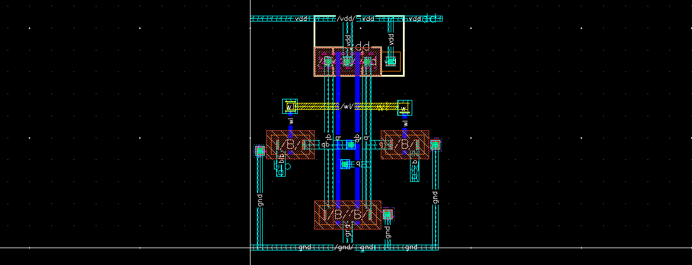

# Reliability-Analysis-of-SRAM-Circuits

## Project Overview

## SRAM Architectures

This project studies five SRAM cell architectures:

- 6T SRAM
- 7T SRAM
- 8T SRAM
- 9T SRAM
- 10T SRAM

### 6T SRAM Schematic

The schematic diagrams are available in the [schematics folder](schematics/).

## Design Methodology

The SRAM cell architectures (6T, 7T, 8T, 9T and 10T) were designed and analyzed using Cadence Virtuoso.

The design process involved:
- Schematic design of each SRAM architecture.
- Read, write and hold operation analysis.
- Stability analysis using Static Noise Margin (SNM).
- Physical layout design using Cadence Layout XL.
- Design Rule Check (DRC) and Layout Versus Schematic (LVS) verification.
  
## Stability Analysis
The stability of the SRAM architectures was evaluated using Static Noise Margin (SNM).

The analysis includes:
- Hold Static Noise Margin (HSNM)
- Read Static Noise Margin (RSNM)
- Butterfly curves for SRAM stability evaluation

The stability diagrams and butterfly curves are available in the [stability folder](stability/).

## Simulation Results
This project analyzes the three operating modes of SRAM cells:

- Read operation
- Write operation
- Hold operation

Simulation results for the 6T, 7T, 8T, 9T and 10T SRAM architectures are available in the [simulation_results folder](simulation_results/).

## Physical Layouts
The physical layouts of the five SRAM architectures were designed using Cadence Virtuoso Layout XL.

- ### 6T SRAM Physical Layout

The layout images are available here:

- [View all SRAM physical layouts](layouts/)
## Tools and Technology

- **Technology:** 180 nm CMOS
- **EDA Tool:** Cadence Virtuoso
- **Layout Tool:** Cadence Virtuoso Layout XL
- **Analysis:** Read, Write, Hold and Static Noise Margin (SNM)
- **Verification:** DRC and LVS
## Repository Structure

## Detailed Documentation
[Links to all images and results]
