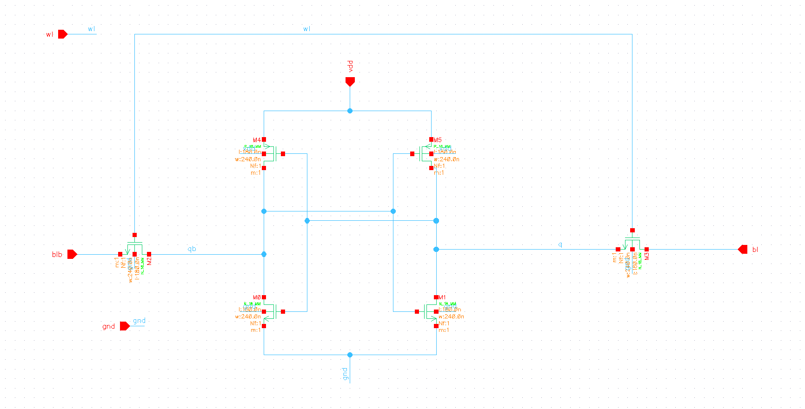

# Reliability-Analysis-of-SRAM-Circuits

## Project Overview

## SRAM Architectures

This project studies five SRAM cell architectures:

- 6T SRAM
- 7T SRAM
- 8T SRAM
- 9T SRAM
- 10T SRAM

### 6T SRAM Schematic

The schematic diagrams are available in the [schematics folder](schematics/).

## Design Methodology

The SRAM cell architectures (6T, 7T, 8T, 9T and 10T) were designed and analyzed using Cadence Virtuoso.

The design process involved:
- Schematic design of each SRAM architecture.
- Read, write and hold operation analysis.
- Stability analysis using Static Noise Margin (SNM).
- Physical layout design using Cadence Layout XL.
- Design Rule Check (DRC) and Layout Versus Schematic (LVS) verification.
  
## Stability Analysis
The stability of the SRAM architectures was evaluated using Static Noise Margin (SNM).

The analysis includes:
- Hold Static Noise Margin (HSNM)
- Read Static Noise Margin (RSNM)
- Butterfly curves for SRAM stability evaluation

The stability diagrams and butterfly curves are available in the [stability folder](stability/).

## Simulation Results
[Representative image]

## Physical Layouts
[Representative image]

## Tools and Technology

## Repository Structure

## Detailed Documentation
[Links to all images and results]
